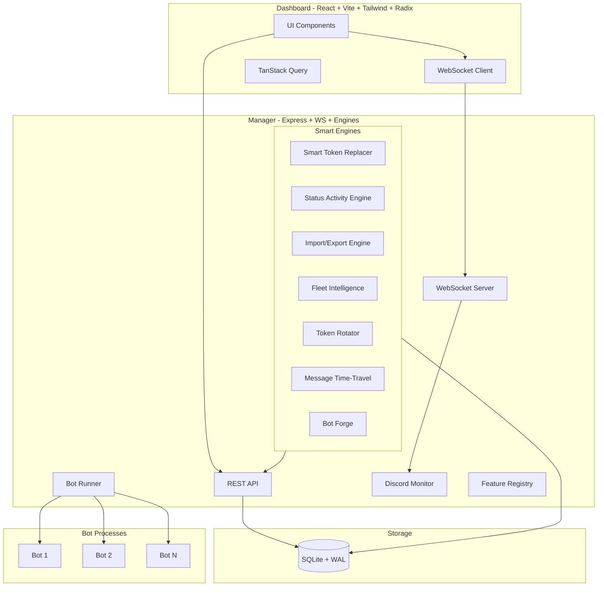

# 🚀 Phantom Fleet Manager

> **Command your legion. Own the night.**

[](https://github.com/phantom1785322-hub/Phantom-Fleet/stargazers)
[](LICENSE)
[](https://nodejs.org)
[](https://discord.js.org)
[](https://github.com/phantom1785322-hub/Phantom-Fleet/actions)
[](https://github.com/phantom1785322-hub/Phantom-Fleet/pkgs/container/phantom-fleet)

---

## Why Phantom Fleet Exists

Most bot managers feel like server control panels from 2015 — clunky, token-leaky, zero intelligence. If you run 10+ bots across 50+ servers, you know the pain:

- **Token rotation** = downtime + prayer
- **Message debugging** = `console.log` archaeology
- **Fleet migration** = manual copy-paste + hope
- **Permission audits** = "wait, which bot has Admin where?"
- **New bot setup** = copy-paste config, forget a feature, discover in production

**Phantom Fleet is different.** It's a *fleet commander* built for operators who run bot armies:

| Feature | Others | Phantom Fleet |
|---------|--------|---------------|
| **Token Security** | Plaintext or basic env | AES-256-GCM, never in API responses, per-fleet keys |
| **Message Intel** | Basic logging | Color-coded edits (🟡), deletes (🔴 blur-reveal), embeds, attachments |
| **Fleet Portability** | Manual copy-paste | One-click encrypted export/import, fleet switching |
| **Dashboard** | Static tables | Real-time WS, keyboard shortcuts, channel nav, send-as-bot |
| **Extensibility** | Hardcoded features | Dynamic feature registry, per-bot toggle, hot-reload |
| **Token Rotation** | Manual find-replace | Smart scanner + **zero-downtime hot-swap** |
| **Status/Activity** | Manual code edit | Visual builder → injects into bot code intelligently |
| **Fleet Intelligence** | ❌ | **Knowledge graph, health scoring, collision detection, attack surface mapping** |

---

## ✨ The Phantom Difference

### 🧠 Fleet Intelligence Engine (The Crown Jewel)
```
┌─────────────────────────────────────────────────────────────┐
│  Knowledge Graph: Bots ↔ Guilds ↔ Permissions ↔ Tokens     │
├─────────────────────────────────────────────────────────────┤
│  🔴 Token Collisions    "Bot A & Bot C share the same token!"│
│  🟡 Permission Gaps     "ModBot lacks ManageMessages in #logs"│
│  🟢 Health Scoring      "Fleet: 87/100 — 2 bots offline"     │
│  💰 Cost Optimization   "Est. $23/mo — consolidate shards?"  │
│  🛡️ Attack Surface      "3 bots with Admin, 1 public dashboard"│
└─────────────────────────────────────────────────────────────┘
```

### 🔄 Smart Token Rotator — Zero-Downtime Hot Swap
```bash
phantom-fleet token:rotate -i 42 -n "new_token_from_discord"
# → Validates token → Encrypts → IPC hot-swap → Bot reconnects → Audit log
# → Zero messages lost. Zero downtime.
```

### ⏪ Message Time-Travel Debugger
```
Message: "!ban @user spam"
Timeline: 
  🟢 [10:00:00] Created
  🟡 [10:00:05] Edited → "!ban @user spam | reason: advertising"
  🤖 [10:00:05] Bot Decision Trace:
      auto_mod: MATCHED (spam rule) → 12ms → action: delete + warn
      message_logger: LOGGED → 3ms
      leveling_system: NO MATCH → 1ms
  🔴 [10:01:00] Deleted (blur-reveal on hover)
```

### 🏗️ Bot Forge — Visual Bot Generator
```bash
phantom-fleet template:generate -t moderation-bot -n "ModBot-Prod" \
  -v MOD_LOG_CHANNEL=#mod-log -v WELCOME_CHANNEL=#welcome \
  -o ./my-bots --lang ts --docker --ci
```
**Generates:** Complete TypeScript project with Discord.js v14, ESLint, Prettier, Docker, GitHub Actions CI, feature modules, config schema, README — ready to deploy.

### 📋 Fleet Templates — Infrastructure-as-Code for Bots
```yaml
# templates/moderation-bot.yaml
extends: base-bot
features:
  message_logger:
    enabled: true
    config:
      ignoredChannels: ["#general"]
      retentionDays: 90
  auto_mod:
    enabled: true
    config:
      rules: !include ../rules/strict.yaml
      logChannel: "${{ guild.channels.mod-log }}"
permissions:
  required: [ManageMessages, KickMembers, BanMembers, ViewAuditLog]
variables:
  MOD_LOG_CHANNEL: { type: channel, required: true }
```
```bash
phantom-fleet template:apply moderation-bot --guild 12345 --name "ModBot-Prod"
```

---

## 🚀 60-Second Start

```bash
# 1. Clone & install
git clone https://github.com/phantom1785322-hub/Phantom-Fleet
cd Phantom-Fleet
npm install

# 2. Setup (generates FLEET_SECRET, creates DB, seeds templates)
npm run setup

# 3. Start (dashboard at http://localhost:3000)
npm start
```

**Docker one-liner:**
```bash
docker run -d -p 3000:3000 -v ./data:/app/data ghcr.io/phantom1785322-hub/phantom-fleet:latest
```

**VPS deploy:**
```bash
curl -fsSL https://raw.githubusercontent.com/phantom1785322-hub/Phantom-Fleet/main/scripts/deploy-vps.sh | bash
```

---

## 📸 Dashboard Preview

| Dashboard | Message Logger | Intelligence |
|-----------|---------------|--------------|
|  |  |  |

*Real-time WebSocket updates • Keyboard navigation (↑/↓ channels, Enter to send, Cmd+K command palette) • Dark mode with Phantom teal accents • Staggered animations • Concentric border radii • Tabular numbers*

---

## 🏗 Architecture



---

## 🧩 Plugin System (SDK)

```typescript
// plugins/my-awesome-feature/index.ts
import { definePlugin } from '@discord-fleet-manager/sdk';

export default definePlugin({
  name: 'my-awesome-feature',
  version: '1.0.0',
  description: 'Does something amazing',
  author: 'You',
  license: 'MIT',
  
  async install({ client, config, logger }) {
    // Listen to all messages across fleet
    client.on('monitor_message', ({ sessionId, message }) => {
      if (message.content.includes('phantom')) {
        logger.info('Phantom detected!', { messageId: message.id });
      }
    });
    
    // Register custom feature for bots
    client.templates.registerFeature('my-feature', {
      enabled: true,
      configSchema: { /* Zod schema */ }
    });
  }
});
```

```bash
# Install plugin
phantom-fleet plugin:install ./plugins/my-awesome-feature
# Or from npm
phantom-fleet plugin:install @myorg/phantom-fleet-plugin
```

---

## 📚 Documentation

| Guide | Description |
|-------|-------------|
| [Getting Started](docs/GETTING_STARTED.md) | 5-min tutorial with screenshots |
| [Architecture](docs/ARCHITECTURE.md) | Technical deep-dive with Mermaid diagrams |
| [Configuration](docs/CONFIGURATION.md) | Every env var, config option explained |
| [Features](docs/FEATURES.md) | Per-feature guide with examples |
| [CLI Reference](docs/CLI_REFERENCE.md) | Every command, flags, examples |
| [API Reference](docs/API_REFERENCE.md) | OpenAPI spec + examples |
| [Security](docs/SECURITY.md) | Threat model, encryption, rotation guide |
| [Deployment](docs/DEPLOYMENT.md) | VPS, Docker, Kubernetes, systemd, PM2 |
| [Development](docs/DEVELOPMENT.md) | Contributing, local setup, testing, adding features |
| [Troubleshooting](docs/TROUBLESHOOTING.md) | Common issues, error codes, solutions |
| [Roadmap](docs/ROADMAP.md) | Public roadmap with issue links |

---

## 🤝 Community & Support

- **Discord:** [discord.gg/phantom-fleet](https://discord.gg/phantom-fleet) — Help, showcase, announcements
- **GitHub Discussions:** [Q&A](https://github.com/phantom1785322-hub/Phantom-Fleet/discussions/categories/q-a), [Ideas](https://github.com/phantom1785322-hub/Phantom-Fleet/discussions/categories/ideas), [Show and Tell](https://github.com/phantom1785322-hub/Phantom-Fleet/discussions/categories/show-and-tell)
- **Twitter/X:** [@PhantomFleetMgr](https://twitter.com/PhantomFleetMgr) — Dev updates, tips, community highlights
- **Newsletter:** [Fleet Intel](https://buttondown.email/phantom-fleet) — Monthly tips, plugin spotlights, roadmap

---

## 🏆 Phantom Fleet Champions

Top contributors get the **Fleet Admiral** role — early access, direct maintainer line, swag.

| Admiral | Since | Contribution |
|---------|-------|--------------|
| @phantom | 2024 | Creator |
| *You?* | *Now* | *First PR?* |

---

## 📄 License

MIT — Use it, fork it, build on it, sell it. Attribution appreciated but not required.

```
MIT License

Copyright (c) 2024 Phantom

Permission is hereby granted, free of charge, to any person obtaining a copy
of this software and associated documentation files (the "Software"), to deal
in the Software without restriction, including without limitation the rights
to use, copy, modify, merge, publish, distribute, sublicense, and/or sell
copies of the Software, and to permit persons to whom the Software is
furnished to do so, subject to the following conditions:

The above copyright notice and this permission notice shall be included in all
copies or substantial portions of the Software.

THE SOFTWARE IS PROVIDED "AS IS", WITHOUT WARRANTY OF ANY KIND, EXPRESS OR
IMPLIED, INCLUDING BUT NOT LIMITED TO THE WARRANTIES OF MERCHANTABILITY,
FITNESS FOR A PARTICULAR PURPOSE AND NONINFRINGEMENT. IN NO EVENT SHALL THE
AUTHORS OR COPYRIGHT HOLDERS BE LIABLE FOR ANY CLAIM, DAMAGES OR OTHER
LIABILITY, WHETHER IN AN ACTION OF CONTRACT, TORT OR OTHERWISE, ARISING FROM,
OUT OF OR IN CONNECTION WITH THE SOFTWARE OR THE USE OR OTHER DEALINGS IN THE
SOFTWARE.
```

---

## 🙏 Built With

- [Discord.js](https://discord.js.org) — The Discord API wrapper
- [Express](https://expressjs.com) — Web framework
- [Better-SQLite3](https://github.com/WiseLibs/better-sqlite3) — Fast SQLite
- [React](https://react.dev) + [Vite](https://vitejs.dev) + [Tailwind](https://tailwindcss.com) + [Radix UI](https://radix-ui.com) — Dashboard stack
- [Cytoscape.js](https://js.cytoscape.org) — Knowledge graph visualization
- [Zod](https://zod.dev) — Schema validation
- [TanStack Query](https://tanstack.com/query) — Server state management
- [Zustand](https://zustand-demo.pmnd.rs) — Client state

---

**Built by Phantom** — *We don't just manage bots. We command fleets.* 👻